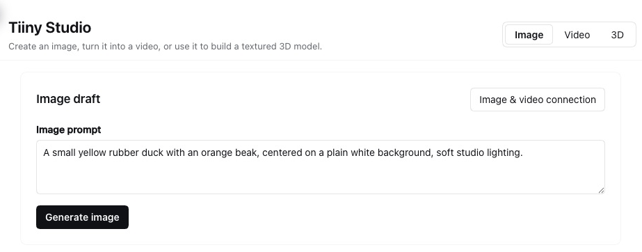
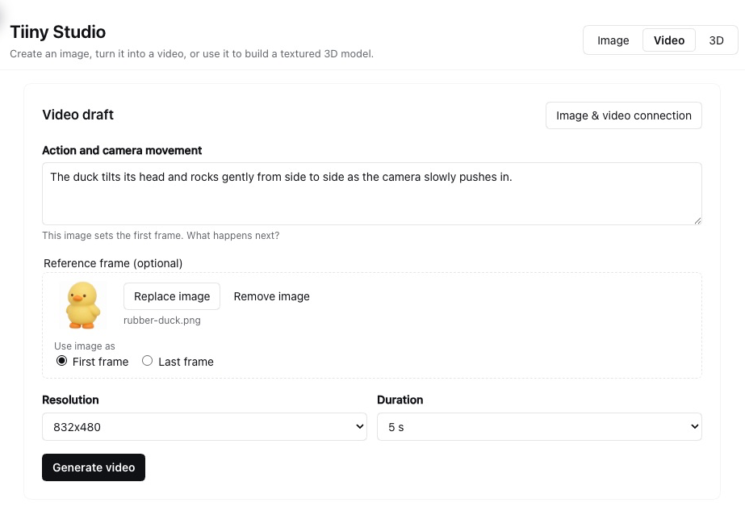
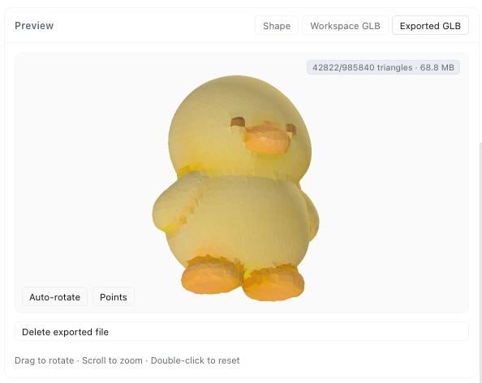

# Tiiny Studio

Tiiny Studio adds an English-language **Image**, **Video**, and **3D** workbench to DeepSeek Harness (DSH). Generate an image on your Tiiny Pocket, then reuse it as a video frame or as the reference for a textured 3D model.

## Install in DeepSeek Harness

You need DSH Desktop 0.2.3-alpha.2 or a compatible build and a Tiiny device that exposes the APIs for the workflows you want to use.

```sh
git clone https://github.com/triskn/dsh-tiiny-video.git
```

1. In DSH Desktop, open **Plugins → Add plugin** and choose the local `dsh-tiiny-video` checkout.
2. Enable the plugin, then open **Tiiny Studio** in the sidebar. Restart Harness after updating the plugin if it still shows an older version.
3. Open **Image & video connection**, enter the device API base URL and key, and select **Save settings**. For 3D, open the **3D** tab and configure **3D connection settings** separately. Find the device key in **TiinyOS → Settings → API Key**.

If you already use Tiiny Video, update the existing `dsh-tiiny-video` package. Studio picks up its media history and the standalone Tiiny 3D project store. Let any standalone 3D jobs finish before disabling that plugin. Keep the `~/.tiiny-video/` and `~/.tiiny-3d/` directories when upgrading.

## Start with an image

In TiinyOS, load a compatible image generation model. In Studio’s **Image** tab, describe the subject, background and lighting, then select **Generate image**. The result appears in **Image & video history** with actions for reusing it.



### Turn it into a video

1. On the completed image, select **Use as first frame** or **Use as last frame**. You can also attach a PNG, JPEG, or WebP file up to 16 MiB directly in **Video**, or leave the reference empty for text-to-video.
2. Load the video model in TiinyOS. Under **Action and camera movement**, describe how the shot moves from the first frame or toward the ending reference. Studio carries the image into the draft and preserves any video prompt you already wrote.
3. Pick an offered resolution and duration, then select **Generate video**. Open **Details** on the completed job to preview or download its MP4.

Each video job accepts one reference. Use **Last frame** with a model that supports an ending reference. The resulting last frame may differ from the reference image.



### Build a textured GLB

1. Select **Use as 3D reference** on the completed image, or attach an image in **3D**. A single clear subject on a plain or transparent background works best.
2. With a compatible 3D model loaded, select **Refresh** if needed, choose **Fast**, **Balanced**, or **High**, and select **Generate complete model**.
3. Follow **Shape**, optional **Simplify**, **Texture**, and **Export**. Select **Exported GLB** to inspect the saved model and use **Download** under **Artifacts** to get the file.

The preview uses a lighter rendering of the saved model. The screenshot below shows an existing duck GLB opened in Studio.



## Use the history

- **Edit / reuse** opens a saved request as a draft. **Retry** starts a new attempt using the saved inputs.
- **Preview proportions → Match reference** appears in video **Details** when the clip and source image have different proportions. This changes the inline preview. The MP4 download keeps its exported proportions.
- **Delete output** removes the selected image or video file and keeps the job for retry. **Delete job** keeps the output by default. To remove both, select the extra checkbox in the confirmation.
- **Delete exported file** removes the selected GLB and keeps its 3D project. **Delete project** keeps the exported GLB by default. Look under **Saved GLB exports** for a kept file.

## Connections and model readiness

| Workspace | Default API base | Example model |
| --- | --- | --- |
| Image | `http://openai.api.tiiny/v1` | `Qwen/Qwen-Image-2.1` |
| Video | `http://openai.api.tiiny/v1` | `lightx2v/MiniMax-H3-Turbo` |
| 3D | `http://api.tiiny/v1` | `Tencent/Hunyuan3d-2.1` |

Images use the OpenAI-compatible `/v1/images/generations` endpoint and videos use `/v1/videos`. The 3D workspace uses Tiiny’s native `/v1/3d` API. Use a reachable base URL for each connection. Harness Credentials stores new keys, and Studio asks for a new key when a saved connection changes to a different origin.

Load the model for your next job in TiinyOS, then refresh the model list in Studio. **Automatic** works when the device reports one matching loaded media model. Select its exact model ID when several are available. The 3D tab can also load a downloaded native 3D model on supported devices after you review and confirm the selection. Opening a tab leaves model selection and job submission to you.

Studio uses one device operation at a time across image, video, and 3D. If the device reports an unfinished or unconfirmed operation, use **Recheck status** and check TiinyOS before resuming. History errors describe the attempt that produced them. Check the current model and device state before retrying.

## Storage and development

- Media history and reusable references live in `~/.tiiny-video/`. Images and videos export to `~/tiiny-videos/` by default.
- 3D projects live in `~/.tiiny-3d/`. Finished GLBs export to `~/tiiny-3d/` by default.
- Optional `ffmpeg` and `ffprobe` enable media inspection and playback remuxing.
- Media overrides include `TIINY_VIDEO_HOME`, `TIINY_OUTPUT_DIR`, `TIINY_BASE_URL`, `TIINY_API_KEY`, `TIINY_MODEL`, and `TIINY_IMAGE_MODEL`. Native overrides include `TIINY_3D_HOME` and `TIINY_3D_BASE_URL`.

The plugin has zero runtime npm dependencies. Use Node.js 20.3 or newer for local development. Run `npm run build:client` after editing the panel sources, `npm run check:client` to verify the bundled client, and `npm test` to run the automated tests against temporary storage and simulated devices.

The panel and `tiiny_media` tool share the same Host operations. Media routes use `/tiiny-video/*` and native 3D routes use `/tiiny-video/3d/*`. Media deletion targets an exact library ID with `scope: "job"` or `scope: "output"`. Use `deleteOutput: true` to include the file when deleting a job. The 3D routes accept separate project and export IDs. Use `removeExport: true` to include the exported GLB when deleting its project.

[MIT License](LICENSE)
